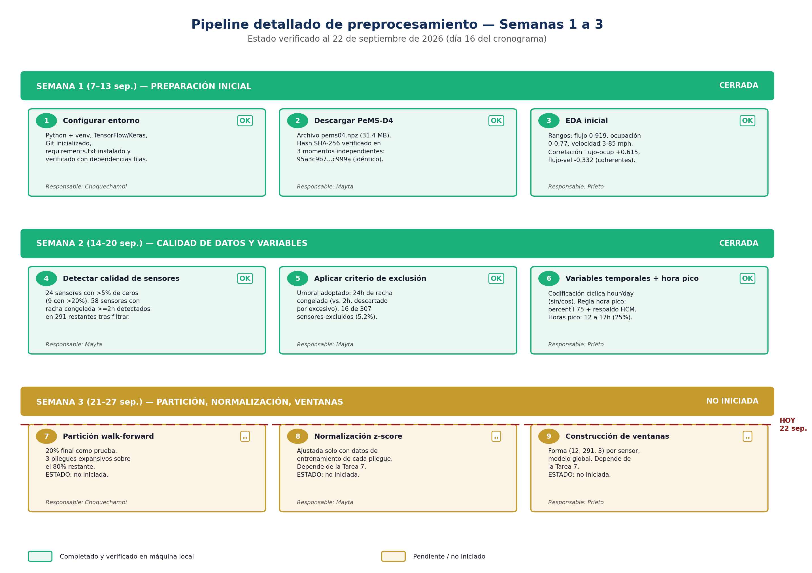

# Evaluación comparativa de arquitecturas de Deep Learning para detección de anomalías en flujo vehicular (PeMS-D4)

Proyecto de Investigación IV — Escuela Profesional de Ingeniería de Sistemas, Universidad Peruana Unión (UPeU), filial Juliaca.

**Estado actual:** Semana 3 de 12 en curso (partición temporal, normalización y ventanas) — ver [`docs/cronograma`](docs/cronograma_ppi_fechas.png).

## Qué es este proyecto

Comparamos 6 arquitecturas de Deep Learning (LSTM, GRU, CNN-1D, Autoencoder, Transformer, híbrido CNN-LSTM-GRU), una línea base estadística no paramétrica y un modelo publicado de referencia (SI-DMSeq), para detectar anomalías en series de flujo vehicular del dataset **PeMS-D4** (307 sensores, Área de la Bahía de San Francisco, enero-febrero 2018).

El protocolo evalúa las 8 condiciones bajo **dos esquemas independientes de etiquetado de anomalías** (proxy estadístico e inyección controlada), para analizar si el ranking de arquitecturas depende de cómo se define una anomalía — un vacío metodológico identificado en la literatura revisada.

## Integrantes

| Integrante | Código | Rol principal en el pipeline |
|---|---|---|
| Mayta Arotaype, Wilbert Alex | 202212463 | Preprocesamiento, calidad de datos, análisis de sensibilidad al etiquetado |
| Prieto Quispe, Juan Enders | 202210704 | Etiquetado, línea base G0, benchmarking computacional |
| Choquechambi Luque, Wrangler | 202220535 | Partición temporal, inyección de anomalías, análisis estadístico |

**Asesor:** Dr. Esteban Tocto Cano

## Metodología, de un vistazo



## Estructura del repositorio

```
.
├── data/
│   ├── raw/              (dataset original, NO versionado - ver Reproducibilidad)
│   └── processed/        (datos ya procesados, NO versionado - se regenera)
├── configs/               (criterios versionados: exclusion de sensores, particion temporal)
├── results/
│   └── eda/               (estadisticas y graficos generados)
├── docs/
│   └── imagenes/          (diagramas y cronograma)
├── src/                   (modulos compartidos, en construccion)
├── notebooks/             (exploracion, en construccion)
├── eda_pems04.py
├── semana2_preprocesamiento.py
├── semana3_particion.py
├── requirements.txt
└── README.md
```

## Reproducibilidad

### 1. Entorno
```bash
python -m venv venv
venv\Scripts\activate.bat          # Windows
pip install -r requirements.txt
```

### 2. Dataset
El dataset **no se versiona en este repositorio** (32 MB, y su integridad se verifica por hash, no por control de versiones). Descárgalo y verifícalo:

```bash
curl -sL -o data\raw\pems04.npz https://raw.githubusercontent.com/Davidham3/ASTGCN/master/data/PEMS04/pems04.npz
certutil -hashfile data\raw\pems04.npz SHA256
```

El hash debe coincidir con:
```
95a3c9b720fffdb85f0330d09bfab41b0b3cad0ca86c0d7d5f3accacb4ac999a
```

Fuente original: Song, C., Lin, Y., Guo, S., & Wan, H. (2020). *Spatial-Temporal Synchronous Graph Convolutional Networks*. AAAI 2020. Ver justificación completa en [`docs/justificacion_dataset_pems04.pdf`](docs/justificacion_dataset_pems04.pdf).

### 3. Ejecutar el pipeline, en orden
```bash
python eda_pems04.py
python semana2_preprocesamiento.py
python semana3_particion.py
```

Cada script documenta sus decisiones en `configs/` y verifica sus propios resultados mediante controles automáticos (`assert`) antes de continuar.

## Documentación de avance

Los informes de cierre semanales, organizados por integrante, con evidencia y justificación metodológica de cada decisión, están en `docs/informes/`:
- Semana 1 — Preparación de datos
- Semana 2 — Calidad de datos y variables temporales
- Semana 3 — Partición, normalización y ventanas (en curso)

## Licencia y datos

Código bajo licencia MIT (ver `LICENSE`). El dataset PeMS-D4 es de origen público gubernamental (Caltrans PeMS); ver la nota de confidencialidad y licencia en `docs/justificacion_dataset_pems04.pdf`.

## Cita

Si este trabajo o su metodología les resulta útil, por favor citen:

> Mayta Arotaype, W. A., Prieto Quispe, J. E., & Choquechambi Luque, W. (2026). *Evaluación comparativa de arquitecturas de Deep Learning frente a una línea base no paramétrica para la detección de anomalías en series de flujo vehicular en autopistas (PeMS-D4)*. Universidad Peruana Unión.
